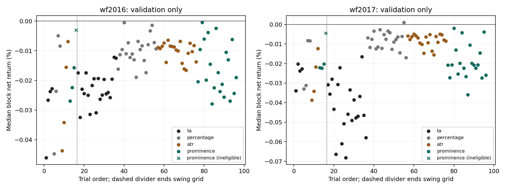
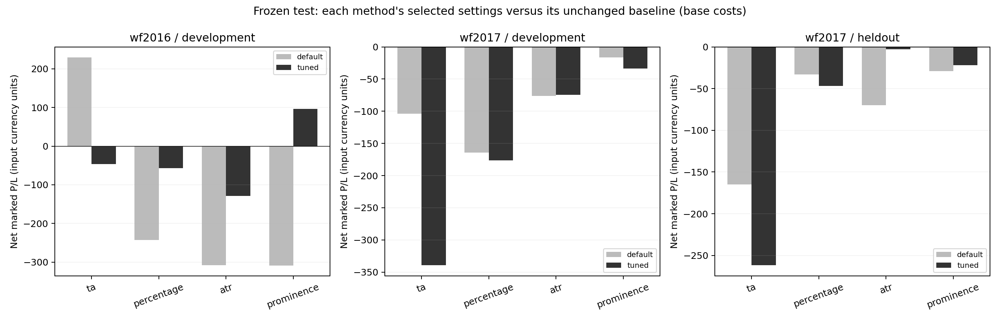
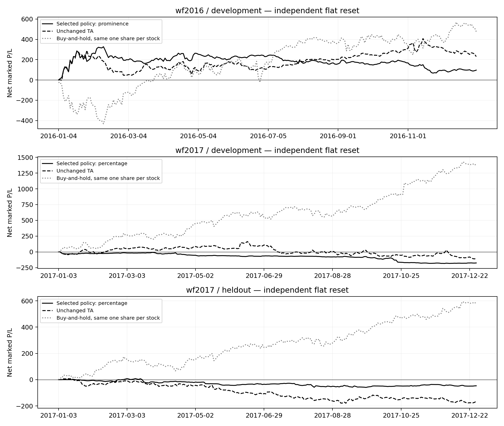
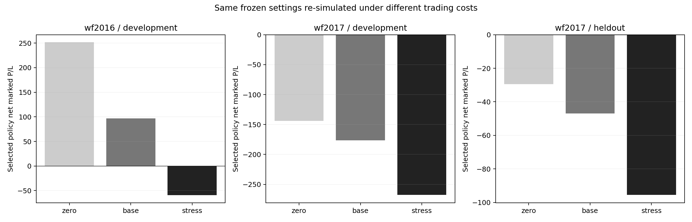

# Parameter-search results

## Finding

The parameter-selection implementation works, but this experiment **does not establish a consistently profitable improvement**. The selected settings lost less than default TA on the reserved-stock comparison, yet they remained unprofitable, did worse than the default percentage method there, and underperformed default TA in both development-stock outer years. Buy-and-hold performed better in all three evaluation groups. Application defaults have therefore not been changed.

The preset is the best **validation-ranked configuration among those tested**, not the best configuration chosen after looking at the final test. Choosing the strongest-looking test arm afterwards would be another round of fitting to the test data.

## What was actually run

The input consists of 60 historical stocks and 75,540 daily OHLCV rows from 8 February 2013 through 7 February 2018. Forty stock histories were added to the previous 20, giving 50,360 additional rows. Forty stocks were used for parameter selection; 20 additional stocks were excluded from that selection. This expands stock coverage rather than adding recent dates.

Two chronological rounds each evaluated 96 configurations: 16 swing-grid trials followed by 80 seeded joint trials. All four methods were included: traditional TA, percentage reversal, ATR reversal and local prominence. There were **192 completed trials, no failed trials, and 95 eligible trials in each round**. A prominence configuration failed the minimum-observation constraints in each round and was excluded from ranking.

The first round selected settings using four half-year blocks in 2014–2015, then tested them on 2016. The second selected settings using six half-year blocks in 2014–2016, then tested them on 2017. The latter configuration was also tested on the 20 reserved stocks in 2017. Every block began flat, with earlier bars used for warm-up. All selections were written before the outer comparisons began.

Each stock account started with 10,000 input-currency units and traded one share at a time. Thus the development portfolios had 400,000 units of starting capital and the reserved-stock portfolio had 200,000. Profits are small relative to that capital because most of the account is idle. These are not fully invested portfolio returns.

## Settings selected before evaluation

| Round | Global method | Swing setting | Trend tolerance | Confirmation | ATR stop multiple | Reward/risk |
| --- | --- | --- | ---: | ---: | ---: | ---: |
| Before 2016 | Local prominence | Minimum prominence 3%; radius 5; distance 3 | 1% | 1 close | 3 | 1.5 |
| Before 2017 | Percentage reversal | Reversal 5% | 0.5% | 2 closes | 2 | 1.5 |

The first winner's median validation return was **−0.000472%**. All 96 first-round scores were negative. It was the highest eligible score, not evidence of a profitable strategy. Its summed validation P/L was −232.64.

The final winner's median validation return was **+0.001010%**, equivalent to a median block P/L of about +4.04 on 400,000 units of capital. It was the only trial in that round with a positive median, but its summed six-block validation P/L was **−64.74**. Three of six blocks were positive. The median objective is deliberately less dominated by one extreme block; it does not guarantee positive total profit.

The final per-method winners were:

| Method | Swing attribute | Tolerance | Confirmation | Stop / target multiple | Median validation return |
| --- | --- | ---: | ---: | --- | ---: |
| TA | Window 3 | 0.25% | 2 | 2 ATR / 1.5R | −0.016562% |
| Percentage | Reversal 5% | 0.5% | 2 | 2 ATR / 1.5R | +0.001010% |
| ATR reversal | Multiplier 3; period 14 | 0.5% | 3 | 1.5 ATR / 1R | −0.004972% |
| Prominence | Minimum 3%; radius 5; distance 3 | 0.25% | 1 | 3 ATR / 1R | −0.001906% |

Here R is the initial stop distance, calculated from ATR at the signal. Trend tolerance is relative to the first trendline anchor price. Confirmation counts consecutive directional closes. Full attributes and stable IDs are in the selection JSON files.

**Figure 1.** Each dot is one tested configuration's median net validation return. Colors distinguish methods; crosses mark ineligible configurations. The vertical dashed line separates the initial swing grid from joint sampling. Trial order is an experiment index, not calendar time. The scarcity of positive scores and small winning margin show why a validation winner alone is weak evidence of economic value.

## Frozen test performance

The following values use base costs: 5-basis-point market-fill slippage, a 0.10 fee per order and 3% annual short borrow. P/L includes realized and final marked open-position P/L. The default TA comparison retains the existing backtest signal/exit settings under the same next-Open execution and cost assumptions.

| Evaluation | Selected method | Selected net P/L | Selected account return | Default TA net P/L | Same-share buy-and-hold P/L |
| --- | --- | ---: | ---: | ---: | ---: |
| 2016, 40 development stocks | Prominence | +96.83 | +0.024206% | +229.89 | +476.24 |
| 2017, 40 development stocks | Percentage | −176.39 | −0.044098% | −103.62 | +1,360.59 |
| 2017, 20 reserved stocks | Percentage | −46.94 | −0.023472% | −164.96 | +576.19 |

On the reserved stocks, selection improved the TA comparison by **118.01 units**, but that is a smaller loss rather than a profit. The default percentage method lost only **33.05**, so changing its target from 2R to the selected 1.5R actually worsened that method's result by **13.89**. The improvement versus TA cannot be attributed solely to parameter tuning: it also changes the swing method.

Across the two independently reset development-stock outer years, the selected policies' P/L sums to **−79.56**, versus **+126.27** for default TA. These sums are an accounting comparison, not a compounded two-year investment return.

**Figure 2.** Light bars use each method's unchanged backtest defaults; dark bars use the same method's earlier-validation winner. Comparing bars within a method isolates the effect of its parameter changes. Improvement is inconsistent: tuned prominence improved 2016, while tuned TA deteriorated in both years. Tuned ATR came closest to break-even on reserved stocks (−2.76), but it was not the globally selected policy. Promoting it based on this observation would use the final test for selection. Panels use different vertical scales and the last contains 20 rather than 40 stocks; use the numerical table and returns for cross-panel comparisons.

**Figure 3.** Solid black is the policy selected using earlier validation, dashed black is default TA, and dotted gray is same-share buy-and-hold. Each panel starts with fresh capital; the paths are not stitched into a continuous strategy with carried positions. The 2017 selected policy is weak across much of the period, rather than suffering only an isolated final-bar loss. Buy-and-hold benefits from price increases in these sampled stocks and stays invested while the strategy may be flat or short.

## Costs, exposure and trade direction

| Selected policy evaluation | Zero-cost P/L | Base-cost P/L | Stress-cost P/L |
| --- | ---: | ---: | ---: |
| 2016 development | +251.45 | +96.83 | −59.44 |
| 2017 development | −143.79 | −176.39 | −267.60 |
| 2017 reserved stocks | −29.50 | −46.94 | −95.48 |

Stress uses 10-basis-point slippage, 0.50 per order and 6% annual borrow. The 2016 positive result disappears under stress. Both 2017 groups lose even without costs, so commissions alone do not explain their weakness.

**Figure 4.** Each bar is a fresh simulation of the same frozen settings under the stated cost assumptions. A lower bar means lower net P/L. This is a sensitivity check, not additional parameter selection. Independent panel scales prevent treating the visual bar height as a common currency scale across groups.

| Selected policy evaluation | Long net P/L | Short net P/L | Closed trades | Open at cutoff | Stock-bars with a position |
| --- | ---: | ---: | ---: | ---: | ---: |
| 2016 development | +203.39 | −106.57 | 142 | 11 | 40.99% |
| 2017 development | −45.15 | −131.24 | 102 | 4 | 15.24% |
| 2017 reserved stocks | +28.48 | −75.42 | 50 | 4 | 15.34% |

Exposure is the fraction of stock/session observations with an open position at the Close, not the fraction of capital invested. Reserved-stock P/L reconciles as **−45.73 realized plus −1.21 marked unrealized = −46.94** after rounding. Only 7 of 20 reserved stocks had positive selected-policy P/L and only 1 beat its same-share buy-and-hold result. Weak short trades are visible, but disabling shorts after seeing these results would be a new hypothesis requiring a separately frozen experiment.

## Verification and interpretation

The real outer comparisons comprised **2,400 stock/configuration/cost simulations**. Independent Decimal reconstruction checked **603,360 equity observations and 12,174 trade records**, with maximum equity error **2.69 × 10⁻¹²** price-currency units. All **72 real-data prefix checks** passed. Replaying the exported selected plan through the pre-existing `backtest.py` reproduced all three reserved-stock cost results to within 10⁻¹⁰. Running the selected preset through the regular application on `data.csv` also completed. A repeated full experiment produced identical trial and portfolio CSV results; changing only plotting support did not change numerical outputs.

These checks support correct integration, bookkeeping and timing within the model. They do not validate the market realism of daily-bar fills, source adjustment conventions or statistical significance. The static historical sample may have survivorship bias; earlier project work already examined some of these years. No dividends, cash interest, FX, market impact or short-locate failures are modeled. A finite search of a partly explored space cannot establish a global optimum.

The appropriate result is to retain the current defaults, keep the selected configuration available for reproduction, and avoid presenting the lower reserved-stock loss as proof of profitability. Any follow-up—such as a predeclared long-only or EMA-filter comparison—should use a fixed new protocol and genuinely untouched data. Full design, commands and sources are in [PARAMETER_SELECTION.md](../../PARAMETER_SELECTION.md).
